<!-- Старый профиль, допиленный: все технологии, твои иконки, каждая кнопка - ссылка -->

  

 

  
  
  
  

 

  
  
  <a href="https://www.jetbrains.com/idea/">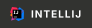</a>

 

  
  
  
  
  <a href="https://discord.js.org/">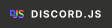</a>
  <a href="https://nodejs.org/en/">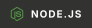</a>
  

  
  
  
  
  
  <a href="https://react.dev/">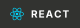</a>
  

 

  
  
  
  
  
  

  
  
  <a href="https://en.wikipedia.org/wiki/Java_(programming_language)">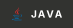</a>
  <a href="https://en.wikipedia.org/wiki/C_Sharp_%28programming_language%29">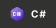</a>
  
  

 

  
  
  
  
  
  

  
  
  
  
  <a href="https://orm.drizzle.team/">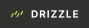</a>

 

  
  <a href="https://en.wikipedia.org/wiki/Comma-separated_values">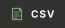</a>
  
  
  <a href="https://developer.mozilla.org/ru/docs/Learn/JavaScript/Objects/JSON/">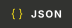</a>

  <a href="https://toml.io/en/">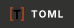</a>
  
  
  <a href="https://developer.mozilla.org/ru/docs/Web/SVG">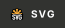</a>

 

  
  
  

 

  <a href="https://obsidian.md/about">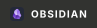</a>
  
  
  
  

 

  
  
  
  
  

 

  
  <a href="https://en.wikipedia.org/wiki/Diff">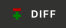</a>
  
  
  
  
  

 

  <a href="https://github.com/yt-dlp/yt-dlp">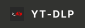</a>
  
  
  
  

 

  
  
  

 

  
  

 

  
  
  
  
  
  
  

