<!-- Подсолнух -->

  

 

  <picture><source media="(max-width: 600px)" srcset="r5d/stack-m.svg"></picture>

 

  <a href="https://t.me/makarasty/"><picture><source media="(max-width: 600px)" srcset="r5d/link-telegram-m.svg"></picture></a>
  <a href="mailto:makarasty@proton.me"><picture><source media="(max-width: 600px)" srcset="r5d/link-proton-m.svg"></picture></a>
  <a href="mailto:makarastydev@gmail.com"><picture><source media="(max-width: 600px)" srcset="r5d/link-gmail-m.svg"></picture></a>
  <picture><source media="(max-width: 600px)" srcset="r5d/link-sep-m.svg"></picture>
  <a href="https://www.npmjs.com/~makarasty"><picture><source media="(max-width: 600px)" srcset="r5d/link-npm-m.svg"></picture></a>
  <a href="https://www.codewars.com/users/MaKarastY"><picture><source media="(max-width: 600px)" srcset="r5d/link-codewars-m.svg"></picture></a>
  <a href="https://monkeytype.com/profile/MaKarastY"><picture><source media="(max-width: 600px)" srcset="r5d/link-monkeytype-m.svg"></picture></a>
  <a href="https://stats.uptimerobot.com/knqRXIY3qY"><picture><source media="(max-width: 600px)" srcset="r5d/link-services-m.svg"></picture></a>

